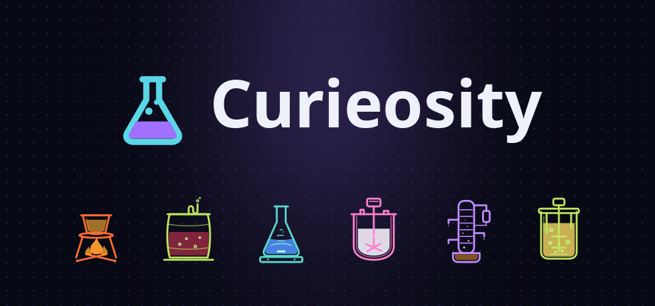

# Curieosity

A free chemistry discovery game. Start with fire, ore and wood; put substances in vessels
and react them; discover 2,704 substances across 2,683 reactions and 27 vessels, from the
first copper smelted to oganesson. Every substance has a page, written for the game or
drawn from Wikipedia and other open sources, with a link to read more.

Curieosity is free, and always will be.

## Play

Download the latest build for Windows, macOS or Linux from
[Releases](../../releases), unzip it, and run `Curieosity`. Progress saves itself.

Mouse, keyboard (Tab, arrows, Enter, Esc) and controllers all work.

On Android (12 or later, 64-bit), install the APK from the
Android workflow's latest run (see below). Swipe the shelf to scroll it; hold a tile a
moment to lift it onto a vessel, or tap a tile and then a vessel. Back works as Esc.

## Build from source

You need [Rust](https://rustup.rs) (stable). On Linux, Bevy also needs
`libasound2-dev libudev-dev libwayland-dev libxkbcommon-dev`.

```
cargo run --release
```

## Tests and the review run

```
cargo test --release                                    unit tests and content checks
cargo run --release -- --autoplay --steps 0             the interaction checks
cargo run --release -- --autoplay --steps 0 --only keyboard,sound   some of them
cargo run --release -- --autoplay                       the checks, then the whole tech tree
cargo run --release -- --autoplay --window 915x412      the same at a phone's size
```

The review run plays the game through its real input, writes a report with screenshots to
`target/review/run_<time>/report.md`, and exits with an error if anything failed. GitHub
Actions runs the tests and a short review on every push, and the whole tech tree weekly.

## Content

The reactions, substances, eras and milestones are written in `tools/data/`
(`authored_content.py`, `authored_tiers.py`, `authored_pages.py`) and built into
`assets/data/` by `python tools/data/gen_authored.py`, which checks that every equation
balances and the whole tree can be played through. It also packs the game's share of the
full scraped library, which is too big for this repository and lives in `library/`
(see `tools/data/pack_library.py`).

## Android

`android/` holds the Android build: a small library crate that starts the game, and the
Gradle project that packs it with `assets/` into an APK. The Android workflow builds it
on GitHub's runners (which have the Android SDK): Actions, then "Android", then "Run
workflow"; the APK is the run's artifact. To build it yourself you need the Android SDK
and NDK, the `aarch64-linux-android` Rust target and `cargo install cargo-ndk`; then, in
`android/`, run the two build steps from `.github/workflows/android.yml`.

## Steam

`cargo run --release --features steam` builds with Steam achievements. Steam has to be
running. The build uses the app id in `CURIEOSITY_STEAM_APP_ID` at build time, or 480
(Valve's test app) until the game has its own. The
achievement list and its icons are in `steam/`, with the store art
(`tools/art/gen_steam_art.py` draws them).

## Licence

The code is licensed under [MIT](LICENSE-MIT) or [Apache-2.0](LICENSE-APACHE), at your
option. The content (data, text, pictures and sounds) is
[CC BY-SA 4.0](LICENSE-CONTENT.md). [CREDITS.md](CREDITS.md) lists the sources and their
terms.
